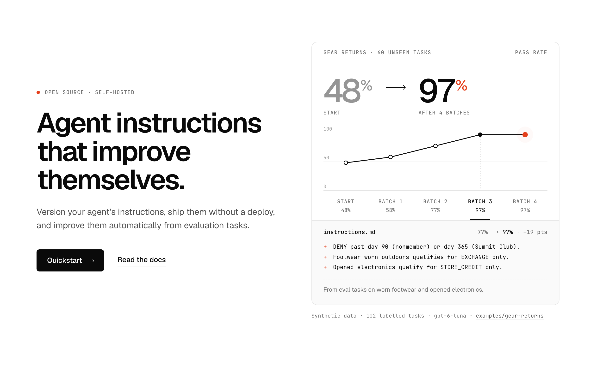

<div align="center">

<picture>
  <source media="(prefers-color-scheme: dark)" srcset=".github/assets/mark-dark.svg">
  
</picture>

# Acclimate

**Agent instructions that improve themselves.**

Acclimate versions your AI agent's instructions, skills and memory, delivers each release to the next job, and improves them with a learning loop. Open source and self-hosted.

[Documentation](https://acclimate.anveld.dev/docs) · [Quickstart](https://acclimate.anveld.dev/docs/get-started/quickstart) · [Self-host](https://acclimate.anveld.dev/docs/operate/self-host) · [Examples](examples/README.md) · [Changelog](CHANGELOG.md)

[](https://github.com/anveld-dev/acclimate/actions/workflows/ci.yaml)
[](https://github.com/anveld-dev/acclimate/releases/latest)
[](LICENSE)
[](https://acclimate.anveld.dev)

</div>

<br>

<a href="examples/gear-returns/README.md">
  <picture>
    <source media="(prefers-color-scheme: dark)" srcset=".github/assets/climb-dark.png">
    
  </picture>
</a>

<p align="center"><sub>A recorded run of <a href="examples/gear-returns/README.md"><code>examples/gear-returns</code></a> on synthetic data. Reproduce it with <code>npm run example:gear-returns</code>.</sub></p>

## What it does

- **Delivery.** Publish the files as a bundle and release a version to a channel. The SDK fetches and verifies the released version each time your application starts a job. To undo a release, roll the channel back to an earlier version.
- **Learning.** Give a bundle tasks with expected answers. Each round proposes five candidate versions and scores them on the tasks. It then releases the one it selects or keeps the current version. Held-out tasks, which the optimizer never sees, check every release, and a confirmed drop reverts it. The loop is based on [Self-Improvement Memory (arXiv 2611.18856)](https://arxiv.org/abs/2611.18856).

Your application runs its agent with its own model credentials. Learning runs in a separate `acclimate-executor` container and uses the model provider that each workspace configures. The service stores that provider's API key encrypted. [How Acclimate works](https://acclimate.anveld.dev/docs) covers what each part does and sees.

```ts
import { createAcclimate, systemPrompt } from '@anveld/acclimate-sdk';

const acclimate = createAcclimate();
const job = await acclimate.job('Gear returns', { channel: 'stable' });
const reply = await runAgent(systemPrompt(job.version.payload), request);
```

## Quickstart

Start Acclimate on your laptop to publish and deliver an example bundle. You need Docker Engine 26 or later with Compose v2.24 or later, Node.js with npm, and Python 3.9 or later for the stack scripts.

```sh
git clone https://github.com/anveld-dev/acclimate.git && cd acclimate
npm run local:up
source .local/stack/env.sh
```

The first start pulls the released images. If none are published for your checkout's version, it builds from source, which takes 10 to 20 minutes. It then:

- prints the console URL and a login;
- gives that login a ready `local-demo` workspace with an example bundle on the `stable` channel;
- starts the executor;
- writes the client settings to `env.sh`.

Run `npm run local:trust` to trust the stack's HTTPS certificate in your browser. The [Quickstart](https://acclimate.anveld.dev/docs/get-started/quickstart) takes you from here to a delivered version, and [The local stack](https://acclimate.anveld.dev/docs/reference/local-stack) describes everything the stack sets up.

## Run a learning loop

Configure a model provider for the workspace and import about 50 tasks, so that each split reaches the 20 admitted tasks that learning needs. Then start learning on the bundle's **Learning** tab. Adopted versions are released automatically, with no approval step.

| Where | Start with |
| --- | --- |
| The local stack | [Run your first learning round](https://acclimate.anveld.dev/docs/tutorials/first-learning-round) sets up a model proxy and runs a round from one script. [`examples/learning`](examples/learning/README.md) gives the **Example agent** bundle 60 ready tasks. |
| The console | [Run a learning loop](https://acclimate.anveld.dev/docs/guides/learning-loop), covering model provider setup, task import, review, and round monitoring. |
| Your own server | An operator sets the optimizer and starts the executor first. See [Enable learning](https://acclimate.anveld.dev/docs/operate/enable-learning). |

## Deliver content to jobs

The SDK fetches and verifies the released version when your application starts a job, and prepares files for agent SDKs such as Codex or the Claude Agent SDK. In the console, **App setup** shows the client configuration for a bundle and channel. See [Deliver content to jobs](https://acclimate.anveld.dev/docs/guides/deliver-content) and the [native repository starter](examples/native-repository/README.md).

Install the TypeScript SDK in your application from npm. This version matches an Acclimate 0.3.0 service.

```sh
npm install @anveld/acclimate-sdk@0.3.0
```

The Codex, Claude, Pi and Cursor plugins also ship under `@anveld`. The Python SDK is `acclimate-sdk` on PyPI. See [Install the SDKs](https://acclimate.anveld.dev/docs/get-started/install) for package links and commands.

## Examples

Programs you can run against the local stack. The [examples index](examples/README.md) lists what each one needs.

| Example | What it shows |
| --- | --- |
| [Gear returns](examples/gear-returns/README.md) | A returns agent learns a shop's policy as tasks arrive in four batches, scored after each on 60 test tasks the loop never sees. This is the run in the chart above. |
| [Support agent](examples/support-agent/README.md) | Answers with the released bundle and picks up improved releases without a deploy. TypeScript and Python. |
| [Ticket triage](examples/ticket-triage/README.md) | Publishes a bundle, imports 64 labelled tickets and runs the learning loop from one script. TypeScript and Python. |

## Self-host

```sh
deploy/init.sh --domain example.com --email you@example.com
docker compose up -d --build --wait
```

The service is written in Rust and stores bundles, versions and releases in PostgreSQL. The web console uses Keycloak sign-in. Each Acclimate release publishes service and console images to GHCR, and attaches the SDK tarballs and Python wheel to its GitHub Release. You can also build them from a checkout. See [Self-host Acclimate](https://acclimate.anveld.dev/docs/operate/self-host) and the [deployment files](deploy/README.md).

## Develop

```sh
npm ci --ignore-scripts
npm run typecheck
npm test
npm run build
```

[Local development and verification](docs/development.md) · [Contributing](CONTRIBUTING.md) · [Architecture](docs/architecture/README.md) · [HTTP contract](contracts/README.md) · [Behavior tests](features/README.md) · [Documentation source](apps/docs/README.md)

## License

Acclimate is licensed under the [Apache License 2.0](LICENSE).
