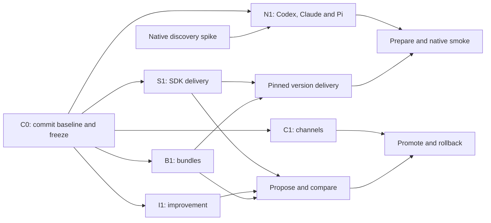

# Parallel implementation work

[Architecture guide](README.md) · [Shared contracts](contracts.md)

This is the implementation work plan. The initial service, SDK, comparison helper, and native mappings were built in parallel in a shared checkout with separate file ownership. Future worktrees need a committed baseline. Use one Rust crate and one PostgreSQL database. The app owns native agent execution and credentials.

## Baseline before worktrees

C0 is the coordinator and sole owner of root scaffolding, manifests, lockfiles, CI, composition, shared contracts and types, the initial migration, and shared auth and idempotency helpers. C0 first settles R0's routes, errors, limits, authorization, retry window, DTOs, database constraints, and the interfaces between modules. Capture exact payload bytes and digest, resolve, version, and complete and incomplete comparison fixtures in `contracts/`; match them in `src/types.rs` and `packages/sdk/src/types.ts`.

C0 creates the root crate and package skeletons, a runnable composition point, the initial migration for all planned records, and usable project-scoped auth and transactional mutation-key helpers. Define how a feature command uses the helper in the same transaction as its writes, and how candidate publication calls bundle persistence. Establish the SDK's verified bundle view and export seam. Provide a local database test setup and commands for each package. Skeletons should compile or run their empty checks, without pretending features exist.

**Commit this baseline, including the relevant architecture docs, before creating isolated feature worktrees from that commit.** Uncommitted files do not appear in those worktrees. C0 announces the commit and fixture/schema freeze. Native discovery may start earlier in a separate spike against fixture content, but its findings must be reconciled with the committed contract before feature implementation.

<!-- diagram:architecture-parallel -->


The diagram shows integration dependencies, not a promise that five agents make the work faster. Once the baseline is frozen, all five streams can write independently against fixtures and agreed interfaces. Pin an explicit version for the first delivery/native proof so unfinished channel promotion does not block it. A live end-to-end result still needs the implementations on its incoming paths.

## Owned streams

Each stream edits only its named files and tests within its directories. No stream edits another's files, the migration, shared types, package manifests, lockfiles, or CI. Send shared changes to C0 with the affected contract, proposed change, and failing case; C0 updates the baseline and coordinates adoption. Use fixture servers or agreed seams while dependencies are unfinished; do not duplicate another stream's production logic.

- **B1 — bundles.** Input: frozen payload schema, auth and mutation helpers, database schema. Own `src/bundles.rs` and its tests. Deliver bundle creation, version publication and metadata/payload reads, validation, immutable exact bytes and digest, and a candidate-publication interface. Check invalid paths and limits, scoped denial, same-key replay/conflict, parent association, and exact fixture bytes/digest against PostgreSQL. C0 owns schema changes B1 discovers.
- **S1 — SDK delivery.** Input: R0, fixtures and verified-view/export seam. Own `packages/sdk/src/client.*`, `cache.*`, `prepare.*`, `index.*` and `packages/sdk/tests/delivery/` (including its fixture server); not shared types or compare tests. Deliver service calls, resolve and verified cache/preparation support. Against a fixture HTTP server check conditional reads, hash before parse, private atomic writes, scoped cache keys, offline age policy, partial downloads, denial, integrity and schema errors, and mutation retries with identical bytes and key. Coordinate exports with I1 through C0; S1 makes any agreed changes in its owned `index.ts`.
- **N1 — native.** Input: verified bundle fixture and SDK preparation interface. Own `packages/codex-plugin/`, `packages/claude-plugin/`, `packages/pi-plugin/`, and `examples/codex-agent.ts`, including their tests. Pin native SDK versions and document actual discovery and refresh behavior. Deliver instruction, skill and memory mapping, explicit collision policy and cleanup; the example app calls the native SDK with its own credentials. Check paths with spaces, collisions and cleanup using fixtures, then run a fresh native session and verify actual discovery once S1 and the native environment are available. Claude and Pi preparation follow the Codex slice and exercises the same interface.
- **I1 — improvement.** Input: comparison fixtures, proposal contract, bundle publication seam, shared transaction helpers. Own `src/improvement.rs`, `packages/sdk/src/compare.*`, `examples/compare-review.ts`, `packages/sdk/tests/compare/`, and its server tests. Deliver bounded recoverable proposal handling, validated candidate edits, comparison records, and an app-supplied execute/grade helper. Check restart and bounded retry behavior, allowed paths, candidate identity, complete and incomplete paired inventories, distinct execution/judge failures and unknown cost. Use a fixture publication seam until B1 lands; real candidate persistence requires B1. Request needed SDK exports through C0; S1 edits its own barrel file.
- **C1 — channels.** Input: resolve/promotion contract, schema and transaction helpers. Own `src/channels.rs` and its tests. Deliver conditional resolution, revision-checked promotion and rollback with history and evidence binding in one transaction. Check ETag/304, concurrent revision conflicts, retained versions, mismatched candidate/parent evidence, evidence against a superseded channel version, explicit unevaluated reasons, authorization and idempotency. Fixture records permit independent tests; real resolution and evidence integration need B1 and I1.

## Integration gates and merge order

C0 integrates and resolves shared changes; feature owners fix their own files. Keep each branch reviewable and run its relevant checks before handoff. A failed gate stays open until the owning stream fixes it and C0 reruns the affected integration checks.

1. Merge B1 and S1; C0 composes the server routes and S1 updates its owned SDK exports. Run migrations on a fresh database. Publish a fixture bundle, read its metadata/payload by explicit version, and verify/cache it. Exercise denial and cache integrity. This proof does not wait for channel code. C1 can land its full module independently against seeded comparison rows; live channel/evidence integration remains a later gate.
2. Merge N1's Codex work and prepare that fetched bundle. The example starts a fresh native session and verifies actual instruction, skill and memory discovery; record the version and digest. Check cache reuse, offline failure and collision handling. Claude and Pi preparation can proceed after Codex works without blocking the first improvement integration. Native smoke needs the pinned SDK and appropriate app-owned credentials/environment; fixture-only checks do not prove discovery.
3. Merge I1 and have C0 connect its transaction-scoped candidate insertion to B1, and S1 add its compare export to the SDK. Propose a bounded edit, compare parent and candidate using app-owned execution and grading, and upload/read the report. Verify incomplete results remain visible and failed proposals leave the published version unchanged.
4. Integrate C1 with B1 and I1: create/resolve a seed channel, test ETag/304, then promote the candidate with matching evidence and expected revision, reject mismatched evidence and stale revisions, resolve the new version, then roll back with history. Existing app jobs remain pinned. Run affected server, SDK and example checks together.

## Copyable brief

```text
Stream: [B1 / S1 / N1 / I1 / C1]
Base commit: [C0's committed, frozen baseline SHA]
Own: [listed files and tests only]
Inputs: [contract, fixtures, helper and dependency seams]
Deliver: [small concrete behavior]
Check: [commands and observable cases from this plan; test database only]
Dependencies: [fixture seam now; live integration later]
Report: commit, checks run and results, unresolved interface/schema requests.
Use fake model calls by default. Native smoke uses only explicitly configured app credentials; report if it cannot run.
Do not edit shared or another stream's files; send those requests to C0.
```
