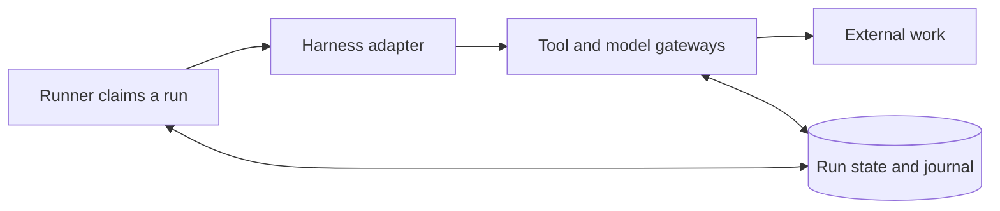
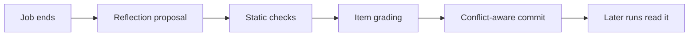

# AgentRun: what to borrow

These source observations informed an earlier runtime exploration. The [current service design](../design/README.md) adopts only the content/versioning lessons, not its execution infrastructure.
**Read-only source review · 2026-11-13**

Snapshot: `077b2fa1c831bdd2bbcb7ed7a0435914f48486b5`, under `.repos/agentrun/`. Links pin that snapshot. No builds or tests were run.

If a worker loses its lease while a model request is in flight, another worker must recover the run without assuming the request never happened. AgentRun separates the harness from state, tool access, model admission, and recovery. This informed the earlier execution-platform proposal; the current service borrows the versioned-content and proposal patterns.

## How it fits together

<!-- diagram:agentrun-architecture -->

The repo separates the service, DSL, decision packages, computer providers, browser tools, clients/CLI, and harness adapters. Those are code boundaries, not proof they deploy independently. [Package map][packages].

## Storage and lifecycle

Runs pin a revision. States are `queued`, `running`, `parked`, `ended`, `stopped`, and `failed`; outcome further separates completion, escalation, stop, and cancellation. Money uses REAL dollars; the earlier Rust runtime proposal chose integer units. [Schema][schema].

Claims select work and advance an epoch (a generation number for the current owner) in one transaction. Renewal checks the lease after locking. The shared write predicate checks run ID, epoch, and deadline; PostgreSQL uses its database clock. That protects writes, not external calls already admitted. [Claims][claims] · [Fence][fence].

Journal commits serialize sequences and can include a run update and command consumption with the effect record. The live view separates committed batches/cursors from held partial output. That's a good console pattern. [Journal][journal] · [Live stream][stream].

## Recovery and spend

The kernel retries replay-safe effects but doesn't blindly repeat a `never` effect after an interrupted intent. Barrier tests expect intent → durable sync → dispatch → outcome; failed sync prevents dispatch. These are inspected test expectations, not passing results. [Kernel][kernel] · [Tests][barriers].

The model proxy retains provider credentials, restricts routes, checks each paid request, and records unknown cost when usage is missing or cut short. A hard cap still needs complete mediation: another credential or network route can bypass it. [Proxy][proxy].

## One concrete adapter: Codex

The adapter uses JSON-RPC over `codex app-server --stdio`, with request IDs, notifications, and blocking tool/approval requests. It initializes experimental capabilities, so pin and test the actual protocol. [RPC client][rpc].

Its session setup disables builtins/bundled skills, supplies host tools and gates, and routes model calls through the proxy. Tool wrappers become journal effects. The local sandbox shim checks binaries and adapts a local machine; inspect launch/confinement rather than trusting copied harness comments. [Adapter][adapter] · [Local shim][shim].

## Learning

<!-- diagram:agentrun-learning -->

Static checks restrict paths, file types/sizes, metadata, edits, and skill contributions from failed jobs. Grading screens generality, planted instructions, secrets, duplicates, contradictions, and risky changes. The commit API handles duplicate merges and changed evidence. [Checks][checks] · [Rubric][grade] · [Commit][commit].

Learned workflow dry runs use synthesized responses. They check wiring along the exercised path, not real answer quality or every branch. Evaluate actual runs before relying on a learned workflow. [Learning contract][learning].

## Security and limits

General workflows are trusted: JavaScript code nodes and validation probes may run with process privileges. A valid JSON workflow isn't an isolation boundary. The owner system models one person per server, not tenant-scoped roles. [Security][security] · [Owner][owner].

The [source audit](source-audit.md) adds test entry points and the details that change our design. Provider breadth, deployment isolation, performance, test health, and real token savings remain unmeasured here.

## Lessons for the smaller service

Borrow immutable content versions, provenance, validation of proposed memory/skill edits, and review before publishing. Runtime supervision and effect recovery belong to the app and native SDK in the current product. The observations above remain useful context for those application authors, not a requirement to build that runtime into Acclimate.

Top-level licensing is [Apache-2.0][license], with [NOTICE][notice] and vendored attribution to check before copying.

[packages]: https://github.com/Parcha-ai/agentrun/blob/077b2fa1c831bdd2bbcb7ed7a0435914f48486b5/package.json
[schema]: https://github.com/Parcha-ai/agentrun/blob/077b2fa1c831bdd2bbcb7ed7a0435914f48486b5/packages/serve/src/store/schema.ts#L1-L138
[claims]: https://github.com/Parcha-ai/agentrun/blob/077b2fa1c831bdd2bbcb7ed7a0435914f48486b5/packages/serve/src/store/sqlite/store.ts#L1533-L1590
[fence]: https://github.com/Parcha-ai/agentrun/blob/077b2fa1c831bdd2bbcb7ed7a0435914f48486b5/packages/serve/src/store/fence.ts#L1-L37
[journal]: https://github.com/Parcha-ai/agentrun/blob/077b2fa1c831bdd2bbcb7ed7a0435914f48486b5/packages/serve/src/store/journal/storage.ts#L330-L398
[stream]: https://github.com/Parcha-ai/agentrun/blob/077b2fa1c831bdd2bbcb7ed7a0435914f48486b5/packages/serve/src/live/stream.ts#L1-L105
[kernel]: https://github.com/Parcha-ai/agentrun/blob/077b2fa1c831bdd2bbcb7ed7a0435914f48486b5/packages/run-adapters/src/kernel/drive.ts#L1-L7
[barriers]: https://github.com/Parcha-ai/agentrun/blob/077b2fa1c831bdd2bbcb7ed7a0435914f48486b5/packages/run-adapters/test/barrier.test.mjs#L21-L117
[proxy]: https://github.com/Parcha-ai/agentrun/blob/077b2fa1c831bdd2bbcb7ed7a0435914f48486b5/packages/run-adapters/src/host/proxy.ts#L1-L75
[rpc]: https://github.com/Parcha-ai/agentrun/blob/077b2fa1c831bdd2bbcb7ed7a0435914f48486b5/packages/run-adapters-codex/src/app-server.ts#L5-L130
[adapter]: https://github.com/Parcha-ai/agentrun/blob/077b2fa1c831bdd2bbcb7ed7a0435914f48486b5/packages/run-adapters-codex/src/adapter.ts#L87-L246
[shim]: https://github.com/Parcha-ai/agentrun/blob/077b2fa1c831bdd2bbcb7ed7a0435914f48486b5/packages/run-adapters-codex/src/host/sandbox.ts
[checks]: https://github.com/Parcha-ai/agentrun/blob/077b2fa1c831bdd2bbcb7ed7a0435914f48486b5/packages/serve/src/learn/check.ts#L260-L317
[grade]: https://github.com/Parcha-ai/agentrun/blob/077b2fa1c831bdd2bbcb7ed7a0435914f48486b5/packages/serve/src/learn/grade.ts#L19-L108
[commit]: https://github.com/Parcha-ai/agentrun/blob/077b2fa1c831bdd2bbcb7ed7a0435914f48486b5/packages/serve/src/learn/commit.ts#L101-L127
[learning]: https://github.com/Parcha-ai/agentrun/blob/077b2fa1c831bdd2bbcb7ed7a0435914f48486b5/packages/serve/src/learn/SPEC.md#L84-L99
[security]: https://github.com/Parcha-ai/agentrun/blob/077b2fa1c831bdd2bbcb7ed7a0435914f48486b5/SECURITY.md#L1-L5
[owner]: https://github.com/Parcha-ai/agentrun/blob/077b2fa1c831bdd2bbcb7ed7a0435914f48486b5/packages/serve/src/owner.ts#L1-L115
[license]: https://github.com/Parcha-ai/agentrun/blob/077b2fa1c831bdd2bbcb7ed7a0435914f48486b5/LICENSE
[notice]: https://github.com/Parcha-ai/agentrun/blob/077b2fa1c831bdd2bbcb7ed7a0435914f48486b5/NOTICE
