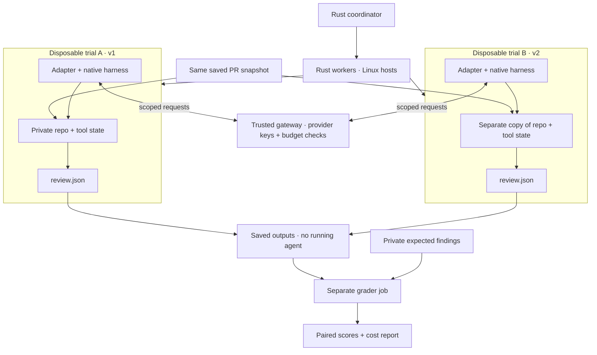

# How evals run

**Archived proposal — superseded by the smaller content service.** [Current overview](../../../../../design/overview.md).
[Design guide](../README.md)

**Proposed design.** Rust schedules the work. Each trial runs in a disposable sandbox. A separate grader scores the saved output.

## One task, twice

A saved pull request contains a retry bug. Version 1 reviews it normally; version 2 has a proposed skill that asks it to check retry handling. We want to see whether that skill helps without giving either version the answer.

1. Pick a saved PR: repository commit, diff, and task instructions. Keep known bugs and expected findings private.
2. Start two fresh containers from the same worker image and fixture snapshot. One gets v1; the other gets v2.
3. Start the selected harness—Claude, Codex, Pi, or fx—through its adapter in each container. Each gets its own workspace, simulated services, and limits.
4. Let each agent read the code and produce `/output/review.json`. Model requests go through the budgeted gateway. Review findings stay in files; nothing is posted to GitHub.
5. Revoke trial access, stop and confirm execution has ended, capture the declared output and usage, then destroy the containers and service state. Retain immutable output records.
6. Give each output to a separate grader, along with the private expected findings. Save its score, missed findings, false positives, and required checks.
7. Repeat both versions on the planned tasks/repetitions. Compare paired scores and costs. A promising search result goes to a **fresh audit evaluation and operator approval** before release.

Twenty PRs × two versions × two repetitions means **80 trials**, not 80 workers at once. Concurrency depends on available workers and budget. Repetition varies run randomness; record a seed where supported, without claiming a hosted model is reproducible.

## What runs where

<!-- diagram:eval-workflow -->

The sandbox backend exposes `create`, `start`, `stop`, `inspect`, and `destroy`. Its profile reports the controls it actually enforces; names alone cannot satisfy admission. The supervisor records the sandbox creation identity so cleanup cannot target a reused container/process ID.

A **worker** is a long-lived Rust supervisor on a Linux host. A **sandbox** is a short-lived container it creates for one trial. One host can run several trials if their limits fit. The control plane, provider credentials, authoritative scores, and private answers stay outside trial containers.

The adapter is operator-installed software, not privileged host code. Its native harness and any agent-generated commands run inside the trial sandbox. The bridge is bound to that trial only; no privileged adapter capability is exposed to candidate code. The host validates every request coming back. The process protocol translates messages; the sandbox and gateway enforce access.

## The v1 sandbox

Use rootless OCI containers on Linux. Development on macOS uses a Linux VM/container host; a normal local subprocess is a separate, weaker development mode. Reject a trial if its required controls aren't available.

| Area | Concrete behavior |
| --- | --- |
| Files | Non-root process, read-only pinned runtime and harness package; private writable `/workspace`, `/tmp`, and `/output`. No host home, sessions, sockets, or credentials mounted. |
| Resources | Per-trial CPU, RAM, process-count, disk/output, and wall-time limits. The worker enforces them outside the agent. |
| Network | Deny direct Internet and host-network access. Permit only the scoped model/tool gateway and that trial's fixture services. Block metadata endpoints and other trials. |
| Models/tools | Gateway keeps service keys and checks trial identity, permissions, and budget. Native built-ins/retries must obey the same gate or be disabled; reject an adapter that cannot meet the profile. |
| Tool state | Each trial gets a private copy of database/API fixtures. V1 evals cannot write to live GitHub, email, production databases, or other real services. |
| Dependencies | Build the pinned runtime image before measurement. No arbitrary package downloads during a trial; fixtures may include a versioned local dependency mirror. |
| Cleanup | Revoke trial capabilities, stop the full process/container group, confirm it is stopped, collect bounded outputs safely, then remove writable volumes and fixture services. A cleanup failure quarantines the sandbox and stops its reuse. |

Both versions start from the same snapshot; they never share writable state or learn from each other. Read-only caches are allowed only when version and access rules match. Each repetition gets another clean copy.

Containers are the v1 isolation choice for one trusted organization. They do not establish hostile-tenant isolation. Drop Linux capabilities, deny privilege escalation and process tracing, and use a qualified syscall/mount policy. The container runtime and host network controls still need qualification; the design does not assume rootless networking enforces these restrictions automatically.

## Setup, execution, and grading

The operator's **domain plugin** runs in separate setup and collection jobs. Setup prepares task-visible files/services and declares output paths; collection receives host-captured output references for structural validation. In this example, the harness sees `/workspace/repo` and `/workspace/task.md`, and writes `/output/review.json`. The worker mounts only those inputs, launches the adapter, and records the exact image/package/task identities. See [plugin authoring](../integrations/sdk.md) for who implements each piece.

The host stops candidate execution before collection. It reads only declared files under bounded paths/size rules; symlinks, archives, and candidate filenames cannot make it read arbitrary host files. It publishes the captured bytes, passes scoped references to `domain.collect`, then validates and commits the submission/result. A collector outage retries collection over the same capture; a malformed candidate submission is a task failure under the rubric. Task failures get a saved result even without a valid review file.

A **grader job** reads the saved submission and protected grading inputs under a separate identity. A PR review can use deterministic format checks plus a tool-free model judge for semantic matching. Submitted text is untrusted evidence, never judge instructions. Structured scores are validated; prompt separation reduces injection risk but doesn't prove the judge is reliable.

If grading needs to execute submitted code, use another fresh, restricted **test sandbox**. The trusted grading controller stays outside it. Feed test inputs across a bounded interface and check outputs outside; don't mount the full answer key or credentials into submitted code. A benchmark requiring hidden tests in the same process needs a separate qualified profile—it cannot claim those tests stay secret from that process. [Evaluation contracts](contracts.md) define the plugin and result shapes.

## Scheduling and recovery

An **evaluation** freezes the versions, tasks, repetitions, limits, grader, and comparison rules before work starts. A **trial slot** is one version/task/repetition. A retry creates a new attempt of that slot, not another sample.

Create every expected slot first. Interleave current/candidate runs in paired task/repetition blocks, with recorded randomized order. Keep images, fixture snapshots, policies, and limits matched. Record actual model metadata/timing; material provider drift can invalidate a comparison.

Store ready jobs and results in PostgreSQL. Workers claim short leases with increasing ownership numbers; expired owners cannot admit new work or attach authoritative results. Publish output bytes first, then commit result, next stage, and required events together. A committed ExecutionResult proceeds to grading after restart; a saved raw capture resumes collection first. An upload without a committed result needs validation/reconciliation, not a guess based on its filename.

| What goes wrong? | What happens next? |
| --- | --- |
| Agent gives a bad answer, crashes, or reaches its task limit | Record task failure and grade it under the planned failure rule. Don't retry until it passes. |
| Worker or fixture infrastructure fails | Apply the bounded, balanced rerun policy declared for both versions. Keep all attempts. |
| Judge times out or returns an invalid score | Retry grading the same saved output. Don't rerun the agent. |
| Model/tool reply is lost | Reuse a recorded outcome or reconcile it. Don't blindly repeat an uncertain effect; unknown usage keeps its budget hold. |
| Campaign is cancelled or out of time/money | Stop new work. Keep missing slots visible and mark the comparison incomplete. |
| Shutdown cannot be confirmed | Quarantine the sandbox and block dependent work until resolved. |

A retry starts a new sandbox and service snapshot unless a declared, compatible checkpoint recovery policy restores that same slot. It never inherits arbitrary leftovers.

The trusted worker classifies failures from evidence. A task timeout isn't the same as a host outage. Cancellation blocks new admissions, but earlier admitted provider work may still finish and cost money. The [runtime effect rules](../runtime/execution.md#effects-and-recovery) cover that case.

## Budget and decision

An improvement **campaign** is a budgeted series of proposals and evaluations. Build/screen/smoke-check each candidate before the full eval. A repaired candidate has a new identity and repeats the affected checks. An SDK call can also evaluate two existing versions without generating a proposal.

A project-authorized campaign owner sets the allowance; the control plane checks it against project limits before accepting the campaign. A stage that cannot reserve its required allowance stays blocked until the declared deadline or authorized budget increase; at the deadline, unstarted slots remain incomplete. Raising a campaign allowance cannot change frozen trial limits; changing those requires a new evaluation.

For example, a $10 allowance with $7 settled spend and a $2 unresolved hold leaves $1 available. A stage needing $2 cannot start. Reconciliation or an authorized increase may unblock it; the hold is never assumed free. See [runtime accounting](../runtime/execution.md#budgets-policy-and-approvals).

Count current-version runs, candidate runs, proposal/build work, judges, infrastructure, and unresolved holds. Bound concurrency and queues. Improvement capacity has its own quota; it cannot take reserved production capacity. Stage allowances and call holds draw from the same campaign allowance without counting spend twice.

Seal a report over the full expected slot inventory: scores, paired differences, required checks, costs, uncertainty, and missing work. Failed tasks count under the frozen rubric; unresolved infrastructure or grading failures leave evidence incomplete. Unknown cost cannot prove savings. Late results create a new report with lineage rather than changing a decision's evidence underneath it.

The [improvement policy](selection.md) chooses what to explore next. Every v1 release additionally needs a fresh, separately controlled audit comparison, complete required evidence, operator approval, and an atomic deployment update. Audit details stay out of proposal access. The [production contract](../runtime/production.md#rollout-and-rollback) owns rollout.

**Still to qualify:** the container/runtime configuration, one native adapter's complete mediation, and the first task/grader. The next implementation step is that end-to-end slice—not automatic search across four unverified integrations.
