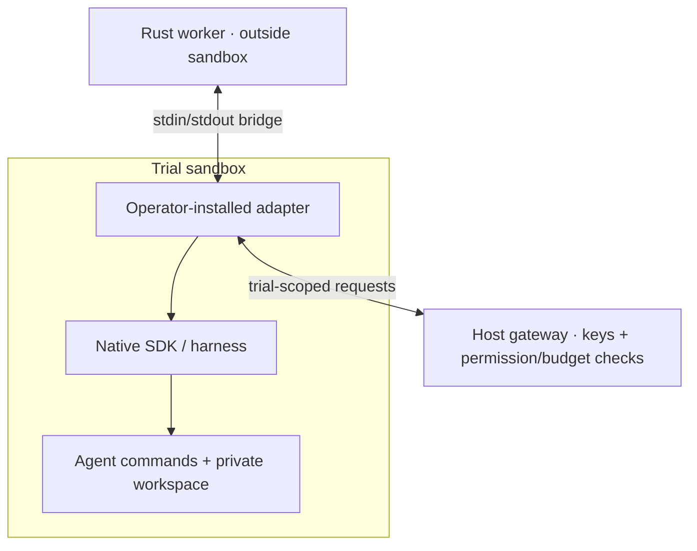

# SDKs and plugins

**Archived proposal — superseded by the smaller content service.** [Current overview](../../../../../design/overview.md).
[Design guide](../README.md)

**Proposed interfaces; no published packages or working adapters.** For a PR review, an app submits a task; a harness adapter runs the native agent and returns a review for the host to save. Read [How evals run](../evaluation/workflow.md) for the execution layout.

## Two SDKs

| SDK | Used for |
| --- | --- |
| Client SDK | Submit/read/cancel jobs, follow events, start comparisons, fetch outputs, and request authorized releases. |
| Extension SDK | Implement harness adapters, tools, task setup/collection, and graders. Handles framing, types, callbacks, and protocol fixtures. |

Start with Python and TypeScript helpers, plus Rust bindings. One versioned schema set defines the messages. Another language can implement the same process protocol; there is no dynamic Rust library ABI.

## Smallest useful harness adapter

Start with one bounded PR-review run: ship an executable image and manifest, implement the handshake and `adapter.describe`, then implement `session.open`, `session.advance`, `session.cancel`, and `session.close`. Open the native session with explicit configuration, pass the task input to it, translate its events and gated model/tool requests, and return the review artifact and final status. Report unsupported capabilities honestly; add checkpoint, inspection, and durable waiting only when the native integration can meet their contracts. The host validates outputs and owns failure recovery. See the [method contracts](protocol.md#worker-to-adapter-methods) and [qualification requirements](../runtime/qualification.md).

## Bringing a harness

To add Claude, Codex, Pi, or fx, write an **adapter** that implements our session interface using its native SDK or RPC. For one PR-review trial:

1. The worker loads the registered adapter image and mounts the selected harness package and task files.
2. Inside the trial container, the adapter starts the native harness with explicit tools/configuration.
3. It translates events and routes model/tool requests through host admission.
4. It returns the declared review output and execution status. The host validates and saves them.

Concretely, `session.open` creates the native session; `session.advance` sends input and reads native events until a reported state. The adapter translates native model/tool interception into host callbacks and native stop/interrupt into `session.cancel`. If supported, it exports/restores a compatible native checkpoint. SDK names and hook coverage vary by harness; the host owns approval, spend, and final state throughout.

<!-- diagram:sdk-process -->



Embedding a native SDK happens **inside** the sandbox. It does not give that SDK or candidate code host privileges. The worker owns the callback connection and binds it to one job; the gateway checks every request. Treat all sandbox messages as untrusted, even when the adapter artifact is approved. No provider keys, grading credentials, or deployment authority enter the trial.

A basic adapter may support only bounded execution. Durable pause/resume is an additional capability, proved for a pinned native integration. Complete mediation is required for the managed eval profile; a launch-only integration can be used in weaker development mode, not silently admitted to that profile. [Protocol](protocol.md) defines the methods; [qualification](../runtime/qualification.md) defines the checks.

## The other plugins

| Plugin | Its job | Where it runs |
| --- | --- | --- |
| Tool provider | Implements a tool after host admission. | Scoped gateway role; local commands execute in the trial sandbox, service calls use approved brokers. |
| Domain | Prepares one task's visible fixtures and declares/collects its output. | Separate operator-controlled setup/collection job; it doesn't run the agent or read hidden answers. |
| Grader | Scores a saved submission against protected criteria. | Separate grading job; submitted code runs in another restricted test sandbox. |

For a Python benchmark, normally split its case setup and scoring into domain/grader plugins; our worker starts the harness adapter. If the benchmark must own its agent loop, a qualified runner adapter replaces that execution step. It still runs one host-assigned trial and cannot create its own untracked experiment. For example, a runner gets one task-input reference, selected AgentVersion, limits, and a trial-scoped gateway context. Its agent loop executes in that trial sandbox and returns saved submission/trace references plus status and usage. Rust owns slot identity and retries; the separate grader owns scores; service keys stay at the gateway. Imported scores remain diagnostic until that path qualifies.

## What an author ships

All four plugin kinds—harness, tool, domain, and grader—use a pinned OCI image plus a separate manifest whose digest the registry verifies. The installed kind and job role select its launch profile and callback allowlist; sharing a format grants no shared privileges. The image contains the executable, native runtime dependencies, and SDK helper. The worker launches the entry point as an argument array and bridges stdin/stdout; diagnostics go to stderr. Candidate packages cannot change this registration.

Illustrative manifest, not a published schema:

```json
{
  "schema": "0.1",
  "id": "claude-review",
  "kind": "harness",
  "image": "registry.example/claude-adapter@sha256:<digest>",
  "entrypoint": ["python", "-m", "review_adapter"],
  "protocol_versions": ["0.1"],
  "profile": "managed-eval",
  "features": ["bounded_execution", "mediated_models", "mediated_tools"]
}
```

Registration pins the manifest/image/native versions and qualification evidence. Feature declarations are claims to verify, not permissions. Don't inherit personal hooks, sessions, login state, or filesystem discovery. Build/selection/release policy stays in trusted platform modules.

## Native integration routes to test

| Harness | Starting point |
| --- | --- |
| Claude | Python/TypeScript Claude Agent SDK. |
| Codex | Official SDK; pinned stdio app-server when deeper control is needed. |
| Pi | TypeScript SDK or RPC, with a pinned bridge extension where needed. |
| fx | JavaScript libfx around its Zig core; a direct Zig adapter can use the same protocol. |

These are integration hypotheses, not working adapters. [Research](../../research/harness-integrations.md) records native surfaces and gaps. Start with one end-to-end integration.

## Client behavior

Submission resolves the chosen version on the server and returns a durable ID. Retrying the same scoped command key and payload returns the original result within its published retention window; a changed payload conflicts. Waiting timeout stops waiting, not the job. Cancellation is explicit.

Events reconnect from committed cursors. Expose expired cursors, revision conflicts, unsupported capabilities, and unknown cost/effects as typed results. The server authorizes every operation; SDK fields cannot raise limits or grant roles.
