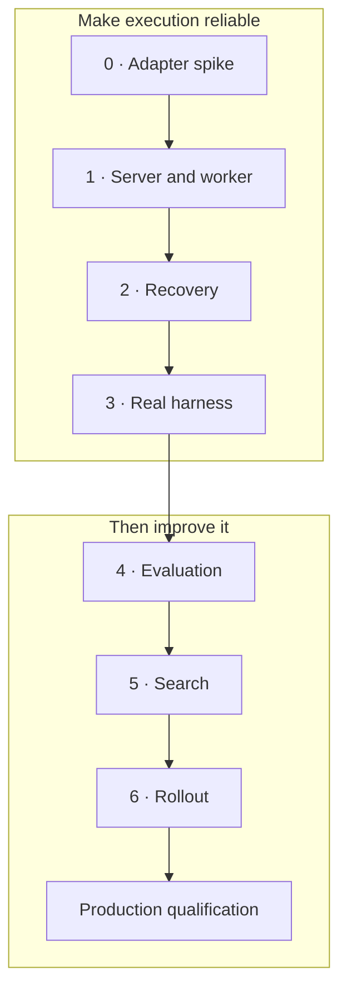

# Build roadmap

**Archived proposal — superseded by the smaller content service.** [Current overview](../../../../design/overview.md).
[Design guide](README.md)

**Proposed order. No runtime is built yet.** Start by running one pull-request review reliably; only then automate improvements. The linked contracts define the acceptance rules.

<!-- diagram:roadmap -->

## 0. Prove the adapter boundary

Freeze protocol fixtures and build a fake harness, extension helpers, Rust host bindings, and a spike against one pinned real protocol. Record capabilities, accounting, checkpoint behavior, shutdown, and any credential or network bypass. Define the worker profile and package manifest. Do not claim guarantees the adapter cannot mediate. See [qualification](runtime/qualification.md) and the [protocol](integrations/protocol.md).

**Demo:** run a bounded task and show its actual capability tier; exercise malformed output, waiting, resumption, and failed shutdown with the fake harness.

## 1. Run a durable job

Build the authenticated server, separate worker, state machine, database and artifact storage, pinned packages, supervision, CLI, and client run/event helpers. Implement the [execution](runtime/execution.md) and [operations](runtime/production.md) contracts, including authorization, bounded output, cancellation, and backup/restore.

**Demo:** submit a review, restart the server or worker, and inspect its durable history. Show that duplicate commands are safe and cross-scope access fails.

## 2. Recover effects safely

Add effect identities, intent and outcome records, approvals, budget holds, admission checks, and restart handling. Test lost replies, unknown usage, competing holds, stale ownership, and approval changes against the [recovery contract](runtime/execution.md#effects-and-recovery).

**Demo:** interrupt an approved tool call and show whether recovery replays its result, repeats it safely, or needs attention.

## 3. Qualify a real harness

Implement a native SDK or RPC adapter, pin its binaries and checkpoint formats, and run the [conformance suite](runtime/qualification.md). Account for paid and background work, mediate tools and credentials, and reject jobs requiring unsupported guarantees. Qualify each worker image and safe upgrade path. Claude, Codex, Pi, and fx are candidates, not certified integrations.

**Demo:** complete a recurring task in the production execution profile and show the recorded qualification evidence.

## 4. Compare versions

Freeze a task domain, data splits, versions, images, grader, budgets, and trial identities. Build isolated setup, collection, and grading using the [evaluation workflow](evaluation/workflow.md) and [contracts](evaluation/contracts.md). Keep candidate, grader, and audit access separate; preserve failed and missing trials and distinguish infrastructure failures from candidate failures.

**Demo:** run two versions on the same saved PR, inspect their reviews and private grading results, retry a grader without rerunning the agent, and show cleanup.

## 5. Test improvements

Start with human-written packages and proposals, then add bounded search, isolated builds, screening, versioned memory and skills, and selection. Bind evidence to immutable inputs; keep audit data sealed and production pinned. Follow [improvement and selection](evaluation/selection.md).

**Demo:** evaluate a proposed skill and record a reasoned accept, reject, or inconclusive decision without changing production.

## 6. Release and operate

Add evidence-bound approval, canaries, rollout limits, rollback, and regression reporting under the [deployment contract](runtime/production.md). Qualify real workloads with load, failure and restore drills, operational objectives, dashboards, alerts, and runbooks. Include unknown effects and costs, permission failures, and evidence integrity in the drills.

**Demo:** canary a version, detect a declared regression, roll back future assignments, and show an existing run remains pinned to its version.

Later work can add worker pools, isolated harness-code evolution, and a console. First choose the recurring task and evaluation cases, confirm mediation and checkpoint support, and decide who operates the deployment and its service objectives.
