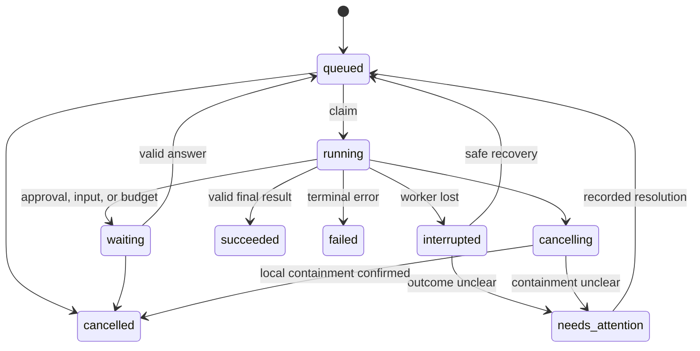
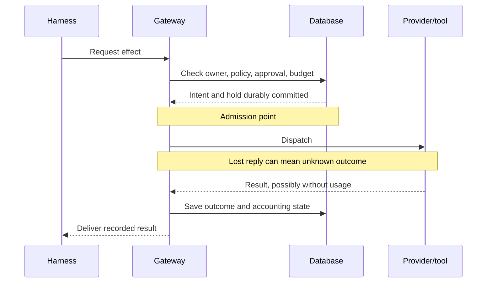

# Execution and recovery

**Archived proposal — superseded by the smaller content service.** [Current overview](../../../../../design/overview.md).
[Design guide](../README.md)

**Draft · 2026-11-13 · No runtime built yet**

For example, an app submits a review with a spending limit. The proposed Rust runtime assigns a worker, records the review and its costs, and recovers or asks for attention if the worker disappears. Nothing described here is built yet.

## Who does what

Rust owns the server, worker supervisor, policy, storage, and improvement coordinator. Existing harnesses keep their own runtimes behind adapters. [How evals run](../evaluation/workflow.md) defines the physical worker/container/gateway layout; [the overview](../overview.md) introduces the terms.

## Product assumptions and scope

Start with one organization, one task domain, one real adapter, and a fake adapter. PostgreSQL and object storage are the production baseline; local mode is for development. Use the managed sandbox profile for evals. Durable waiting/recovery are enabled only after the pinned adapter qualifies.

Hosted multi-tenancy, a workflow DSL, the console, and broad integration coverage come later. [Production](production.md) owns deployment/operations; this page owns runtime state and effects.

## Domain model

A run pins its AgentVersion, policy, and budget. Attempts belong to the same logical session. Stable effect IDs identify model/tool operations across attempts. Approvals authorize exact effects; reservations hold their budget. Immutable artifacts carry provenance and scoped access. [Evaluation contracts](../evaluation/contracts.md) define trial and grading records.

## Architecture and ownership

| Module | Owns |
| --- | --- |
| Core | IDs, state transitions, retry rules, and pure policy checks. |
| Store | Atomic commands/events, claims, approvals, reservations, and migrations. |
| Supervisor | Process identity, attempts, shutdown, and restart checks. |
| Adapter | Harness protocol, events, capabilities, and checkpoints. |
| Gateways | Admission, credentials, dispatch, tool policy, and accounting. |
| Artifacts | Digest checks, publication, access, and cleanup. |
| Improvement | Proposals, evaluation jobs, history, and search decisions. |
| Release | Evidence checks and atomic active-version updates. |

Start with `acclimate-core`, `acclimate-store`, `acclimate-runtime`, and `acclimate` for CLI/service entry points. The runtime owns the adapter host; harness-specific integrations run as versioned plugin processes. Python/TypeScript extension helpers and Rust bindings share one wire contract. Add `acclimate-improve` once evaluation works. Skip a dynamic library ABI; see [SDKs and plugins](../integrations/sdk.md).

Use an authenticated HTTP interface for clients/workers; the CLI uses the same command semantics. Local development may use an owner-only socket. Keep authorization and transaction ordering inside the owning module.

## Run lifecycle

<!-- diagram:run-lifecycle -->

These are the main paths; cancel also applies to interrupted/attention states. Success, failure, and cancellation are terminal. A rerun gets a new Run ID.

Waiting has a typed reason and pending-operation ID. Park before dispatch, save the checkpoint, and release the worker. A valid answer queues another attempt. An adapter without that checkpoint contract can't offer durable waiting.

Cancellation blocks new admissions and requests shutdown. It can't revoke an already committed dispatch intent. Even after local containment is confirmed, earlier external work may finish or leave an unknown charge. Keep it visible. Later reconciliation can add evidence without reopening the run. Fencing alone doesn't confirm containment.

Mutations use scoped idempotency keys and expected revisions. Same key/payload returns the first result; changed payload conflicts. Record command outcome, state, and events together.

## Storage and durability

Use PostgreSQL as production authority for state, journals, leases, reservations, and release/deployment transactions. Workers submit scoped commands through the control plane. Store immutable packages, inputs, outputs, checkpoints, and evidence in object storage.

SQLite/local artifacts remain a development mode, with explicit WAL, sync, and foreign-key settings. They aren't the distributed production substrate. See [runtime options](../../research/rust-runtime-options.md) for those tradeoffs.

Tables cover agents/packages/versions, runs/attempts/sessions, events/commands/effects, approvals/reservations, artifacts/references, and an outbox. Improvement adds proposals, builds, evaluations/trials, search decisions, releases, and deployments.

Enforce unique per-run event sequences, per-session effect IDs, scoped command keys, trial slots, and version digests. Events carry schema version, IDs, sequence, type, payload/artifact refs, timestamp, and ownership generation. Deduplicate adapter events by source identity. Order by sequence, not time.

State and events commit together. Stream durable events with reconnect cursors; mark partial output as provisional. Bound buffers and let slow readers catch up from storage. Expired cursors return a snapshot cursor, not a silent gap. Version schemas and preserve decoders or migrate explicitly.

Publish artifacts before referencing them: upload under an immutable key, verify bytes/digest/size, confirm availability, then commit the scoped reference. Local mode uses durable atomic file publication. A crash may leave an orphan, never a successful result pointing to missing bytes. Cleanup follows live references, active publications, and retention windows, including rollback dependencies. Digests do not grant access. Back up and restore consistent state plus referenced artifacts.

## Effects and recovery

An effect ID belongs to the logical session and operation, so it survives worker changes. Store the canonical request digest, policy/adapter versions, retry class, and downstream idempotency key where supported.

<!-- diagram:effect-admission -->

Approval consumption, budget reservation, and intent commit together. No commit means no dispatch. **Committed intent is admission, not the physical send.** If cancel/lease loss wins first, admission fails. If intent wins first, a paused dispatcher may still send later. A final check helps but can't close the database-to-network gap.

Save outcome and accounting state before returning a result. Known usage settles the hold. A complete result without usage can return after saving `usage_unknown` and retaining a conservative hold. Final settlement waits for reconciliation.

| Retry class | Intent exists, outcome is missing |
| --- | --- |
| Replayable | Repeat only if its contract allows it. Reads can still cost money or change over time. |
| Idempotent | Reuse the downstream key or query the result, within the provider's guarantees/key lifetime. |
| Nonrepeatable | Mark unknown; block dependent work until reconciliation or an explicit operator decision. |

Unknown isn't failure, zero cost, or proof nothing was sent. A model retry can create another bill. Don't release unresolved holds because a worker died.

On restart, check process/container creation identity, checkpoints, effects, and adapter capabilities. V1 doesn't promise arbitrary process reattachment. Confirm termination, then resume a supported checkpoint; otherwise use `needs_attention`.

Production workers use leases and increasing ownership generations. Check the store's clock within write/admission transactions. Old workers can't write results or admit new work. Previously admitted work may still send or finish; the current owner or reconciliation service records its evidence. A storage fence isn't a process kill or exactly-once guarantee. See the [source audit](../../../../source-audit.md#claims-and-fencing-are-implemented-in-storage).

## Harness adapter contract

Target Claude, Codex, Pi, and fx through one language-neutral adapter interface. Spike one pinned integration first, using native SDKs/RPC and AgentRun as references. Confirm its real capabilities before locking it in. Keep native protocol and transcript repair out of the core. See [integration research](../../research/harness-integrations.md).

Adapters report binary/protocol versions, supported config, event schema, cancellation, checkpoint format, resume mode, tool mediation, spend telemetry, fork support, and sandbox compatibility. Test `restart_only`, `checkpoint_resume`, or `reattach` per version.

The [adapter protocol](../integrations/protocol.md) owns session methods, bidirectional host callbacks, event barriers, checkpoint identity, and typed failures. The extension SDK supplies authoring helpers, not additional permissions. Each adapter must qualify the native ordering and mediation it relies on; see [conformance](qualification.md).

| Guarantee | Needs |
| --- | --- |
| Durable pause/resume | Tested checkpoints and pending-operation recovery. |
| Tool approval | Complete mediation for granted tools. |
| Hard platform spend cap | Bounded admission, full credential/egress mediation, known prices, and upper-bound holds. |
| Advisory spend tracking | Visible unknown usage/cost and bounded runtime. |
| Untrusted execution | An available sandbox meeting the requested restrictions. |

A plain CLI can still help in trusted/advisory development mode. Production admission must meet the job's declared execution policy. Reject unsupported guarantees rather than guessing or silently weakening them.

## Process supervision and isolation

Use Tokio with bounded, concurrent stdout/stderr draining. Save process creation identity and sandbox handles. Cancel gracefully, enforce a deadline, terminate the process group/container, and reap it. Exit without a valid final result isn't success. Dropping a Tokio child doesn't kill it by default ([Tokio Child](https://docs.rs/tokio/latest/tokio/process/struct.Child.html)).

Use the Linux/container backend and lifecycle in [the sandbox profile](../evaluation/workflow.md#the-v1-sandbox). `trusted_local` uses the user's authority and is development only. Production task profiles may authorize real service effects; the managed eval profile denies them. Never silently fall back to local execution.

Keep provider secrets in the host/gateway. Use short-lived scoped capabilities, redact before persistence, and control trace access/retention. Redaction isn't proof all secrets are gone. Hostile multi-tenancy needs stronger isolation and separate security work.

## Budgets, policy, and approvals

Use integer money units and separate token dimensions. Pin the price catalog, model, maximum output, and hold basis. Reserve an upper bound before paying; settle with measured usage. Strict mode rejects unknown prices or unbounded requests. It covers admitted work under that price model, not arbitrary provider billing changes.

Count in-flight holds and child work against the parent budget. Track money, calls, wall time, output, and storage separately. Improvement budgets also include proposer, critic, grader, build, evaluation, and infrastructure costs.

Bind approval to the logical effect, canonical arguments, run/session, scope, policy revision, expiry, and approver. Attempts are audit context. A new attempt revalidates ownership, digest, and policy before consuming approval with intent. Changed, denied, or expired decisions can't authorize new intent.

Effective permission is the intersection of platform, agent, run, and sandbox grants. Learning can't expand it. Revocation blocks the next admission and may cancel active work; it can't undo admitted operations.

## Versioned learning

[Improvement policy](../evaluation/selection.md) owns proposal scope and selection. [Evaluation](../evaluation/workflow.md) owns testing. [Production](production.md#the-improvement-artifact) owns package provenance and release. Those processes consume run evidence; they cannot change active runs or the runtime's permissions.

## API and developer experience

The [client SDK](../integrations/sdk.md#client-behavior) and CLI use the same authorized server operations. Planned CLI: `agent register`, `run start/inspect/events/cancel`, `approval answer`, `version inspect`, `eval run`, `improve propose/search`, and `release promote/rollback`. None is implemented yet.

API mutations return revision and event sequence. Run inspection shows version, state, pending action, attempt, known/unknown/reserved spend, outputs, and recovery reason. Expose artifacts and cursor-based events through the same access rules.

Trace run/attempt/effect/package/evaluation/deployment IDs. Measure queue wait, runtime, refusals, lease loss, recovery, unknown costs/effects, approval age, and artifact/evaluation/rollout failures. Publish deployment-specific SLOs and recovery objectives before launch; prove them with load, failure, and restore tests.

## Implementation choices and validation

Start with Tokio, Serde, tracing, SQLx, clap, and Axum; choose versions during the spike. [Runtime research](../../research/rust-runtime-options.md) records the tradeoffs.

Prove the contracts through the fake adapter and one real integration, then PostgreSQL/storage fault cases. The [roadmap](../roadmap.md) gives build order; [qualification](qualification.md) lists required interface tests. Performance, recovery, and isolation remain unproven until that work passes.
