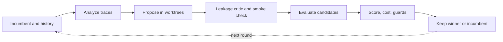

# RRSI: improve the harness, measure the change

These source observations informed an earlier runtime exploration. The [current service design](../design/README.md) adopts only the content/versioning lessons, not its execution infrastructure.
**Read-only source review · 2026-11-13**

Snapshot: `be50316e1db05914068a973f322770ef08ed7ba1`, under `.repos/rrsi/`. No scripts, tests, or experiments were run.

For example, a candidate might change review instructions, then compete against the current harness on scored tasks. RRSI edits the harness around a frozen model: prompts, tools, control flow, memory, and context management. It doesn't train new model weights. The repo has coding, workspace, and engineering instances. The authors report transfer beyond the evolve sets; those results weren't reproduced here. [README][readme] · [Paper](https://arxiv.org/abs/2609.24972) · [Project](https://regularized-rsi.com/).

## Observed implementation

<!-- diagram:rrsi-search -->



The loop checks the recorded harness tree, analyzes successes/failures, drafts candidates, evaluates screened ones, selects, records history, and moves the evolution branch. Cached reports/results help restart. Each candidate gets its own Git worktree; that isolates edits, not execution or secrets. [Loop][loop] · [Git operations][git].

The proposer declares components, hypotheses, and edits. Diff checks validate tags; the critic combines patterns and LLM review, with bounded repair. Declarations don't prove semantic edit count or safe code. [Proposer][propose] · [Critic][critic] · [Components][components].

The edit budget shrinks on a cosine schedule:

```text
b(t) = ceil(round(b_min + (b_max-b_min) * (1+cos(pi*t/T))/2, 9))
```

`t` is clamped to `[0,T]`; `T <= 0` returns `b_max`. This limits declared edits per candidate, not the final harness's size. [Schedule][schedule].

Stalls use `S[t] - S[t-w] <= delta` after enough rounds. Search can reserve slots for untried components. Pruning uses recent best measured component gain; no recent evidence can also trigger a suggestion. Bundle attribution isn't causal proof. The proposer usually sees a recent history view, not the whole ledger. [History][history].

## Selection, exactly

For the current accepted harness (the incumbent), use score/cost `(S,C)`, best accepted score `S*`, candidate `(S',C')`, structural novelty `n`, and noise band `delta`:

```text
dS = S' - S
dC = (C' - C) / C, or 0 when either cost is absent/zero

reject if S' < S* - delta
if dS > delta: require dC <= beta0 + beta1*dS
else:          require ws*dS - wc*dC + wn*n > 0
require all domain guards

pick the highest-scoring admissible candidate
if none pass, keep the incumbent
S* = max(S*, selected score)
```

Floor and cost allowance are inclusive; shaped utility is strictly positive. Equal scores keep input order. The incumbent isn't in the candidate argmax, so a slightly lower score can replace it within the floor. Novelty counts structural component categories without prior winning edits. [Selector][select] · [Components][components].

Score is a weighted reward mean. Cost averages positive observed token counts, skipping absent/nonpositive values. Missing cost therefore looks like zero relative change. Also, aggregation trusts domain adapters to supply every expected trial slot. The current comparison design keeps expected cases and missing cost explicit. [Evaluation][evaluate].

Calibration prefers repeated baseline score variance; otherwise it bootstraps trials within tasks and scales to a two-evaluation difference. A tiny/unvarying sample can give zero tolerance. The coverage statement depends on assumptions; it's not a guarantee. [Calibration][calibrate].

## Domain boundary and limitations

Domains supply splits, execution/scoring, trace rendering, smoke checks, component signals, critic patterns, and critical guards. The core doesn't need to know a benchmark's trajectory format. [Domain interface][domain].

Git ref movement, history, and frontier JSON are separate writes. A crash can leave them inconsistent. Promotion checks ancestry then updates the ref without an expected-old-value guard. Useful experiment recovery isn't a production transaction. [Round completion][round] · [Ref update][ref].

For the current service, borrow parent-bound proposals, recorded comparisons, complete expected cases, and explicit missing costs. The app executes and grades. A reviewer promotes a bundle; the full search policy and isolated worker infrastructure are not v1 requirements. Ablations remain useful before attributing a gain to one edit.

The repo includes [core tests][tests], not test results from this review. It declares [Apache-2.0][license]; third-party harnesses carry their own licenses.

[readme]: https://github.com/google-research/rrsi/blob/be50316e1db05914068a973f322770ef08ed7ba1/README.md
[loop]: https://github.com/google-research/rrsi/blob/be50316e1db05914068a973f322770ef08ed7ba1/rrsi/loop.py#L231-L346
[git]: https://github.com/google-research/rrsi/blob/be50316e1db05914068a973f322770ef08ed7ba1/rrsi/gitops.py
[propose]: https://github.com/google-research/rrsi/blob/be50316e1db05914068a973f322770ef08ed7ba1/rrsi/propose.py
[critic]: https://github.com/google-research/rrsi/blob/be50316e1db05914068a973f322770ef08ed7ba1/rrsi/critic.py
[components]: https://github.com/google-research/rrsi/blob/be50316e1db05914068a973f322770ef08ed7ba1/rrsi/components.py#L72-L108
[schedule]: https://github.com/google-research/rrsi/blob/be50316e1db05914068a973f322770ef08ed7ba1/rrsi/schedule.py#L28-L54
[history]: https://github.com/google-research/rrsi/blob/be50316e1db05914068a973f322770ef08ed7ba1/rrsi/history.py#L113-L211
[select]: https://github.com/google-research/rrsi/blob/be50316e1db05914068a973f322770ef08ed7ba1/rrsi/selection.py#L28-L137
[evaluate]: https://github.com/google-research/rrsi/blob/be50316e1db05914068a973f322770ef08ed7ba1/rrsi/evaluate.py#L104-L135
[calibrate]: https://github.com/google-research/rrsi/blob/be50316e1db05914068a973f322770ef08ed7ba1/rrsi/calibrate.py#L28-L114
[domain]: https://github.com/google-research/rrsi/blob/be50316e1db05914068a973f322770ef08ed7ba1/rrsi/domain.py
[round]: https://github.com/google-research/rrsi/blob/be50316e1db05914068a973f322770ef08ed7ba1/rrsi/loop.py#L306-L346
[ref]: https://github.com/google-research/rrsi/blob/be50316e1db05914068a973f322770ef08ed7ba1/rrsi/gitops.py#L121-L126
[tests]: https://github.com/google-research/rrsi/blob/be50316e1db05914068a973f322770ef08ed7ba1/tests/test_core.py
[license]: https://github.com/google-research/rrsi/blob/be50316e1db05914068a973f322770ef08ed7ba1/LICENSE
