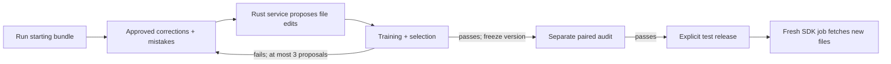

# Live learning qualification

This checks whether better **files** improve later agent jobs. It uses the real Rust proposal queue, PostgreSQL, SDK cache, Codex plugin and Luna. It does not change model weights or publish to your existing workspace.

The task is fictional payment-incident triage: choose a next step without executing payments. The starting bundle has instructions, a skill and generic memory. It lacks the gateway's local retry contract. Approved corrections and observed mistakes give the proposer something useful to learn.

For cumulative learning, use the [harder twenty-round test](twenty/README.md). It starts from the previously learned files, measures each proposed update against the current best, and reserves a separate final audit.

The [large audit](large/README.md) adds distributed evidence and cross-job consistency. The [helper repair](repair/README.md) tests reusable model-authored skill code. [Stress-test results](../../docs/research/self-improvement-stress-test.md) retain the failed text-based runs and the final qualification.



## Run it

Requires Python 3.11+, Node 22.22+, Rust, PostgreSQL server binaries, and working Codex SDK authentication with access to `gpt-6-luna`. The wrapper creates and removes its own database cluster. Keep its output directory new each time.

```sh
# Makes paid model calls: at most 48 bounded Luna turns.
npm run qualify:self-improvement:live -- \
  --pg-bin /opt/homebrew/opt/postgresql@18/bin \
  --output artifacts/self-improvement/my-run
```

Use your Python interpreter if the project venv is absent; this wrapper uses only the standard library. Omit `--pg-bin` when PostgreSQL binaries are already on `PATH`. Builds the Rust service unless `--skip-build` is set. A clean pass usually takes 31 model turns; retries can take more. Each experiment has a 25-minute deadline. A failed run exits nonzero and retains its evidence.

## What counts as a pass

1. Freeze separate training, selection, audit and future-job inputs before model calls.
2. Run twelve training incidents with the starting bundle. Require actual mistakes.
3. Send approved provider facts and training results through the service's proposal API. The model returns bounded text edits; Rust saves an immutable child version.
4. Reject task identifiers, account names, grader references and host paths in reusable files. Run the candidate on training and selection cases. Only these development failures may inform another proposal.
5. Freeze the selected candidate. Compare it with the unchanged parent on 12 audit incidents, in four three-incident batches, twice per arm. Require a complete report, all candidate decisions correct, and a higher score than the parent. Audit answers never return to the proposer.
6. Submit that report to the real evaluation API. The test controller explicitly approves a release to its disposable channel.
7. Re-resolve through the same SDK cache. Require the new version, correct decisions in a fresh job, worse results from a pinned-parent control, and rejection of a stale release revision.

The grader checks actions and idempotency arguments, including expiry boundaries, scope changes, in-flight/completed receipts, missing keys and an injected customer instruction. Missing, duplicate or malformed decisions retain the full denominator. Explanations must exist; their prose quality is not graded.

## Inspect the evidence

| File | What it proves |
| --- | --- |
| `frozen-dataset.json` | Inputs existed before model runs. |
| `parent.json`, `candidate-*.json` | Exact bundle bytes, versions and digests. |
| `proposal-*-input.json`, `proposal-*-model.json` | What the proposer saw and actually wrote. |
| `*-results.json`, `runs/*.json` | Decisions, grades, native commands, resource reads, warnings and token usage. |
| `selection.json` | Development failures and bounded retry history. |
| `comparison*.json`, `review.json` | Paired audit, bound evidence and explicit test approval. |
| `summary.json` or `failure.json` | Final outcome, cache/release checks and limits. |

Artifacts are private by default. USD cost stays unknown rather than being guessed. See the [qualification report](../../docs/research/self-improvement-qualification.md) for recorded runs.

## Boundaries

- This is supervised content improvement: the app supplies authorized corrections and a trusted grader. The service does not infer reliable truth from arbitrary transcripts.
- The controller is an opt-in example, not an always-running production learner. Its automatic approval applies only to its disposable test channel. Production releases still need an authorized review.
- All model calls use Luna through the Codex SDK. A local authenticated adapter connects the Rust service's OpenAI-compatible proposer to that SDK; a direct vendor endpoint is not qualified here.
- Workspaces contain only files prepared from the version and task inputs. Network is disabled and native jobs are read-only. This is not hostile-tenant isolation; native commands are retained for inspection.
- These are synthetic variations of one policy task. Passing does not establish broad agent improvement, another harness's behavior, payment safety or production readiness.

## Code map

- `domain.ts`: fixtures, approved policy, independent grader and content screening.
- `luna.ts`: fresh Codex threads and per-job evidence.
- `service.ts`: disposable real Rust API and Luna proposer adapter.
- `run.ts`: bounded propose/test/release loop using public SDK APIs.
- `../../scripts/testing/self_improvement.py`: owned PostgreSQL/process lifecycle.

AgentRun's [learning bench](https://github.com/Parcha-ai/agentrun/blob/077b2fa1c831bdd2bbcb7ed7a0435914f48486b5/packages/serve/learn-bench/README.md) informed the repeated on/off jobs and fictional fixtures. RRSI's [critic](https://github.com/google-research/rrsi/blob/be50316e1db05914068a973f322770ef08ed7ba1/rrsi/critic.py) informed the bounded edits and task-leakage checks. We inspected these cloned sources; we did not run their benchmarks.
